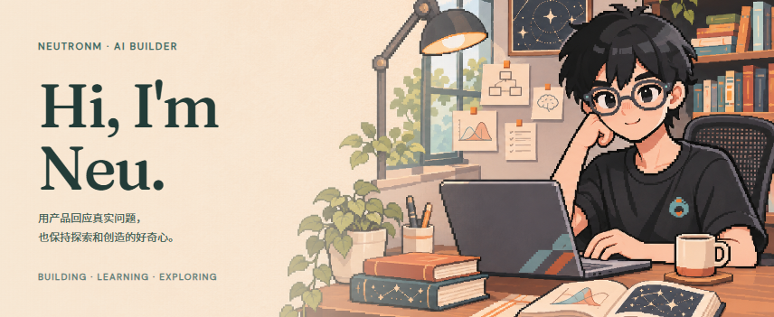
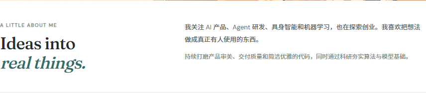
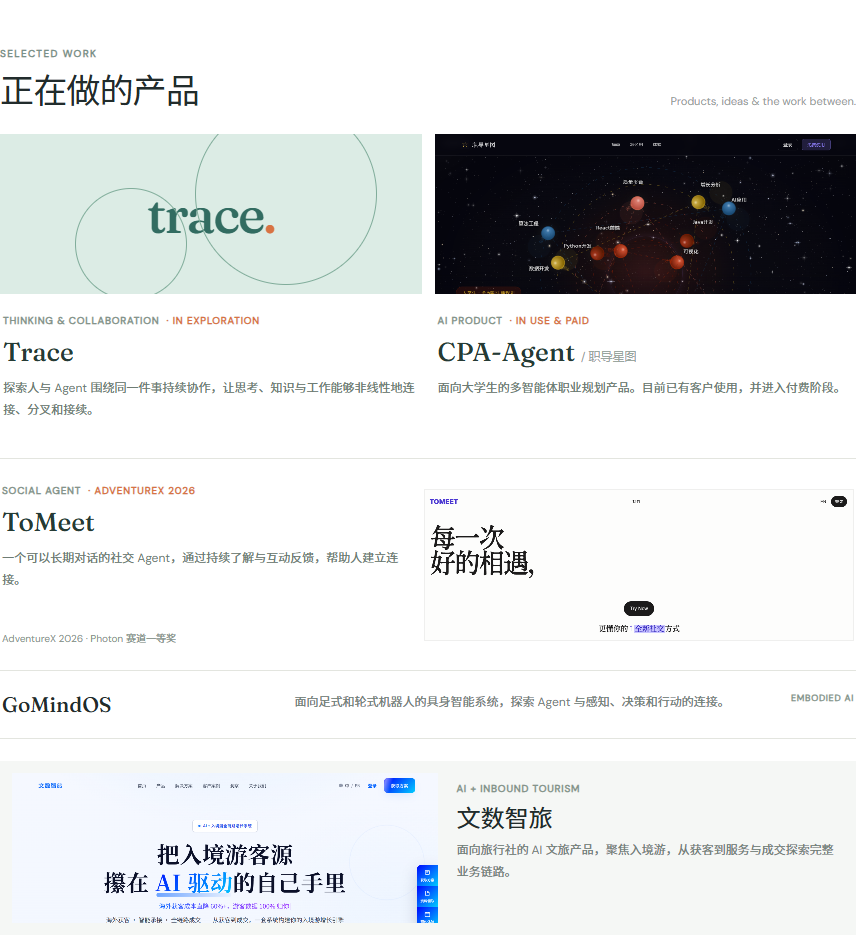
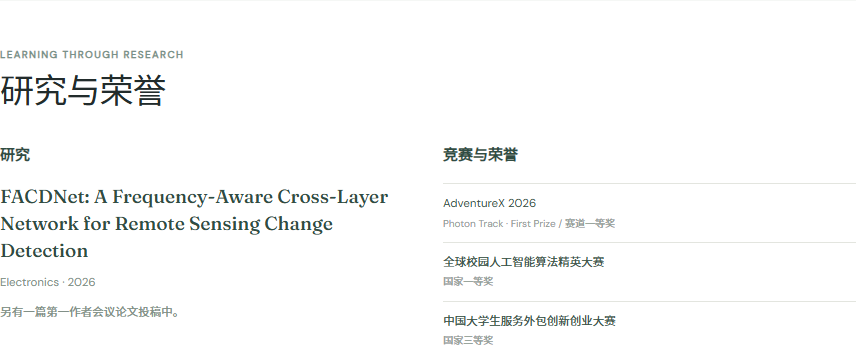
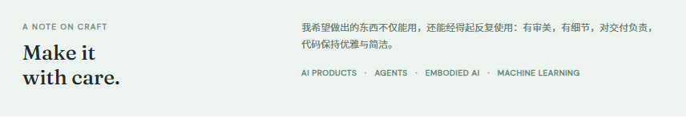
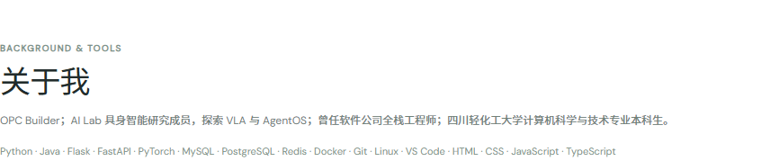

<strong>简体中文</strong> · <a href="./README_EN.md">English</a>

<picture>
  <source media="(max-width: 600px)" srcset="./assets/v2/hero-zh-mobile.png">
  
</picture>

<picture>
  <source media="(max-width: 600px)" srcset="./assets/v2/intro-zh-mobile.png">
  
</picture>

<picture>
  <source media="(max-width: 600px)" srcset="./assets/v2/work-zh-mobile.png">
  
</picture>

**产品入口** &nbsp; [CPA-Agent 仓库](https://github.com/WHaoxM/cpa-agent) · [职导星图官网](https://www.xingtulabs.top/) · [ToMeet 官网](https://www.tomeet.chat/) · [ToMeet 仓库](https://github.com/toMeetADX/TOMEET_Backend) · [文数智旅官网](https://www.zhilvtravel.com/)

<picture>
  <source media="(max-width: 600px)" srcset="./assets/v2/research-zh-mobile.png">
  
</picture>

[阅读 FACDNet 论文 ↗](https://www.mdpi.com/2079-9292/15/11/2416)

<picture>
  <source media="(max-width: 600px)" srcset="./assets/v2/craft-zh-mobile.png">
  
</picture>

<picture>
  <source media="(max-width: 600px)" srcset="./assets/v2/about-zh-mobile.png">
  
</picture>

[联系我 ↗](mailto:freezingm2020@outlook.com)

文字版介绍 / Accessible text

我是 NeuTronM，也可以叫我 Neu。我关注 AI 产品、Agent 研发、具身智能与机器学习，也在探索创业；持续打磨产品审美、交付质量、代码，以及算法与模型能力。

- **Trace**：探索人与 Agent 围绕同一件事持续协作，让思考、知识与工作能够非线性地连接、分叉和接续。
- **CPA-Agent · 职导星图**：面向大学生的多智能体职业规划产品。目前已有客户使用，并进入付费阶段。
- **ToMeet**：一个可以长期对话的社交 Agent，通过持续了解与互动反馈，帮助人建立连接。
- **GoMindOS**：面向足式和轮式机器人的具身智能系统，探索 Agent 与感知、决策和行动的连接。
- **文数智旅**：面向旅行社的 AI 文旅产品，聚焦入境游，从获客到服务与成交探索完整业务链路。

**研究**：[FACDNet](https://www.mdpi.com/2079-9292/15/11/2416)，Electronics，2026；另有一篇第一作者会议论文投稿中。

**竞赛与荣誉**：AdventureX 2026 Photon 赛道一等奖；全球校园人工智能算法精英大赛国家一等奖；中国大学生服务外包创新创业大赛国家三等奖。

**经历**：OPC Builder；AI Lab 具身智能研究成员，探索 VLA 与 AgentOS；曾任软件公司全栈工程师；四川轻化工大学计算机科学与技术专业本科生。

**工具**：Python · Java · Flask · FastAPI · PyTorch · MySQL · PostgreSQL · Redis · Docker · Git · Linux · VS Code · HTML · CSS · JavaScript · TypeScript

