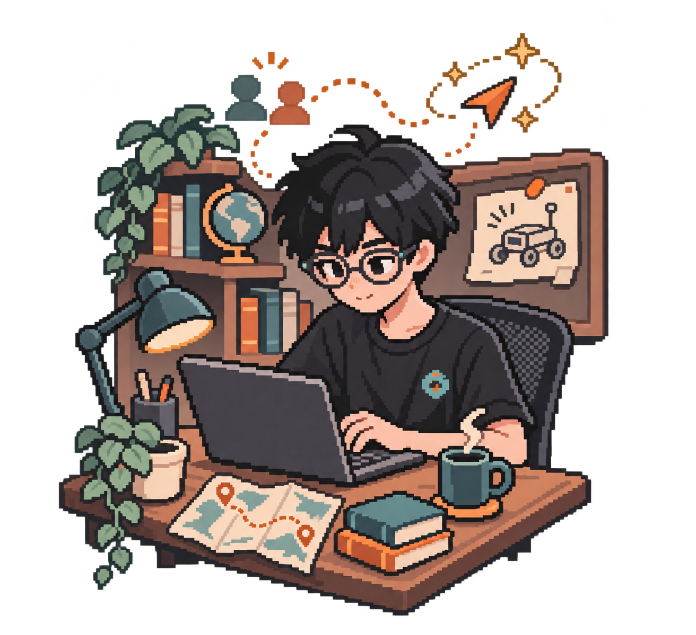

<strong>简体中文</strong> · <a href="./README_EN.md">English</a>

# Hi, I'm Neu.

<picture><source media="(min-width: 600px)" srcset="./assets/builder-vignette.png" width="245"></picture>

**把想法做成产品，也把问题带回研究。**

我是 NeuTronM，一名 AI 产品 Builder。我做 Agent，探索具身智能与机器学习；在真实交付中打磨审美、代码与创造力。

[正在构建](#正在构建)　·　[研究与荣誉](#研究与荣誉)　·　[联系我](mailto:freezingm2020@outlook.com)

 

## 正在构建

从人与 AI 如何共同思考，到智能体如何走进真实场景。

<picture><source media="(min-width: 600px)" srcset="./assets/trace-threads.png" width="150"></picture>

<h3>Trace 人与 Agent 协作 · 探索中</h3>

让人、知识与 Agent 围绕同一件事持续关联；思考可以分叉，形成的理解和工作也能被接续。

不只是记录对话，而是探索如何让思考、沉淀与协作一起发生。

 

<picture><source media="(min-width: 600px)" srcset="./assets/career-stars.png" width="150"></picture>

<h3><a href="https://www.xingtulabs.top/">CPA-Agent · 职导星图</a> AI 产品 · 商业化</h3>

面向大学生的多智能体职业规划产品，连接能力画像、人岗匹配与职业发展。

**已有客户使用，并进入付费阶段。** [产品官网 ↗](https://www.xingtulabs.top/)　/　[项目仓库 ↗](https://github.com/WHaoxM/cpa-agent)

 

<h3><a href="https://www.tomeet.chat/">ToMeet</a> 社交 Agent · AdventureX 2026 Photon 赛道一等奖</h3>

通过长期对话、持续了解与互动反馈，帮助人建立连接。[官网 ↗](https://www.tomeet.chat/) · [仓库 ↗](https://github.com/toMeetADX/TOMEET_Backend)

<h3>GoMindOS 具身智能</h3>

面向足式与轮式机器人，探索 AI Agent 与感知、决策和行动的连接。

<h3><a href="https://www.zhilvtravel.com/">文数智旅</a> AI × 入境游</h3>

面向旅行社，探索从海外获客、智能承接到业务成交的服务链路。[官网 ↗](https://www.zhilvtravel.com/) · [仓库 ↗](https://github.com/SyncingTravel/XT_MVP)

## 研究与荣誉

**研究**　持续打磨算法与模型能力，关注机器学习与具身智能。

- [FACDNet: A Frequency-Aware Cross-Layer Network for Remote Sensing Change Detection](https://www.mdpi.com/2079-9292/15/11/2416) — *Electronics*, 2026
- 另有一篇第一作者会议论文投稿中。

**竞赛**

- **AdventureX 2026** — Photon 赛道一等奖
- **全球校园人工智能算法精英大赛** — 国家一等奖
- **中国大学生服务外包创新创业大赛** — 国家三等奖

## 关于我

OPC Builder · AI Lab 具身智能研究成员，探索 VLA 与 AgentOS 曾任软件公司全栈开发工程师 · 四川轻化工大学计算机科学与技术专业本科生

我希望做出的东西不仅能用，也值得被反复使用：对交付负责，在细节中打磨审美，让代码优雅而简洁。

**工具**　Python · Java · Flask · FastAPI · PyTorch · MySQL · PostgreSQL · Redis · Docker · Git · Linux · VS Code · HTML · CSS · JavaScript · TypeScript

**联系**　[freezingm2020@outlook.com](mailto:freezingm2020@outlook.com)
