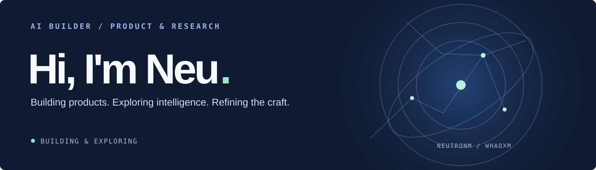
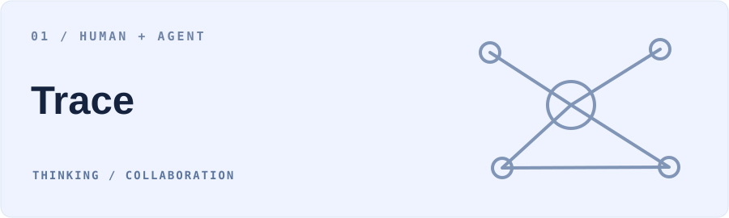
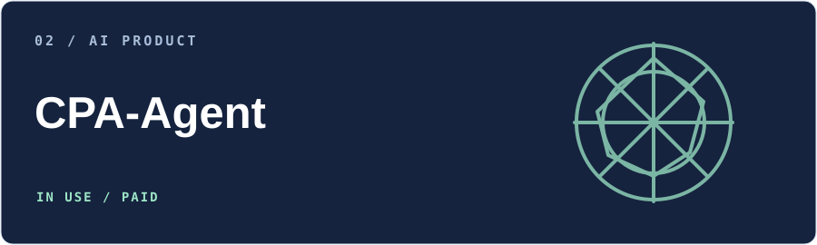
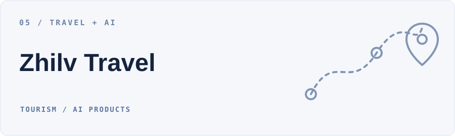

<strong>English</strong> · <a href="./README_ZH.md">简体中文</a>

I’m **NeuTronM**, or **Neu**. I build AI products and agents, and explore embodied intelligence, machine learning, and entrepreneurship. I want to turn ideas into products people can actually use.

I’m also continuing research in algorithms and models, while refining my eye for design, taking responsibility for the details of delivery, and learning to write simpler, more elegant code.

### 01 / SELECTED WORK

Exploring continuous human–agent collaboration: connecting thinking, knowledge, and work around the same subject, with room for non-linear exploration and continuation.

A multi-agent career-planning product for university students, connecting capability profiles, job matching, and career development. Already used by customers and in the paid stage.

[Repository ↗](https://github.com/WHaoxM/cpa-agent) · [Frontend demo ↗](https://whaoxm.github.io/cpa-xingtu/)

A social agent that gets to know users through ongoing conversation and helps people form connections, learning from feedback along the way.

[Repository ↗](https://github.com/toMeetADX/TOMEET_Backend) · AdventureX 2026 · Photon Track First Prize

An embodied intelligence system for legged and wheeled robots, exploring how AI agents connect real-world perception, decision-making, and action.

An AI travel product for travel agencies focused on inbound tourism, exploring the journey from overseas customer acquisition to intelligent service and business conversion.

[Official website ↗](https://www.zhilvtravel.com/)

### 02 / RESEARCH

Research helps me build a deeper foundation in machine learning, algorithms, and models.

- [**FACDNet: A Frequency-Aware Cross-Layer Network for Remote Sensing Change Detection**](https://www.mdpi.com/2079-9292/15/11/2416) — *Electronics*, 2026.
- A first-author conference paper is currently under submission.

### 03 / HACKATHONS & COMPETITIONS

- 🏆 **AdventureX 2026** — First Prize, Photon Track
- 🥇 **Global Campus Artificial Intelligence Algorithm Elite Competition** — National First Prize
- 🥉 **China Undergraduate Service Outsourcing Innovation & Entrepreneurship Competition** — National Third Prize

### 04 / ABOUT & PRACTICE

- **OPC Builder** exploring AI-native products and entrepreneurship.
- **Embodied AI research member at AI Lab**, exploring Vision-Language-Action (VLA) and AgentOS.
- Former **full-stack developer** at a software company.
- **Computer Science undergraduate** at Sichuan University of Science & Engineering (SUSE).
- Working on product taste, thoughtful delivery, and elegant, simple code.

**Interests** &nbsp; AI Products · Agents · Embodied AI · Machine Learning

**Languages & tools** &nbsp; Python · Java · Flask · FastAPI · PyTorch · MySQL · PostgreSQL · Redis · Docker · Git · Linux · VS Code · HTML · CSS · JavaScript · TypeScript

**Contact** &nbsp; [freezingm2020@outlook.com](mailto:freezingm2020@outlook.com)
