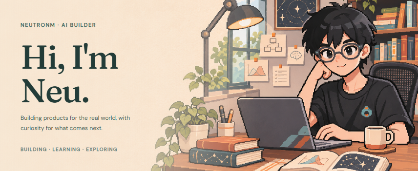
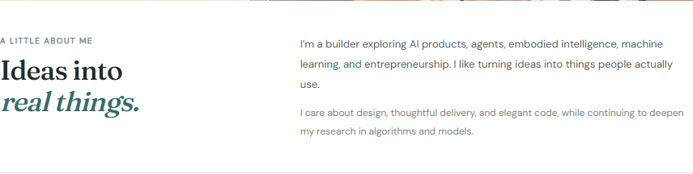
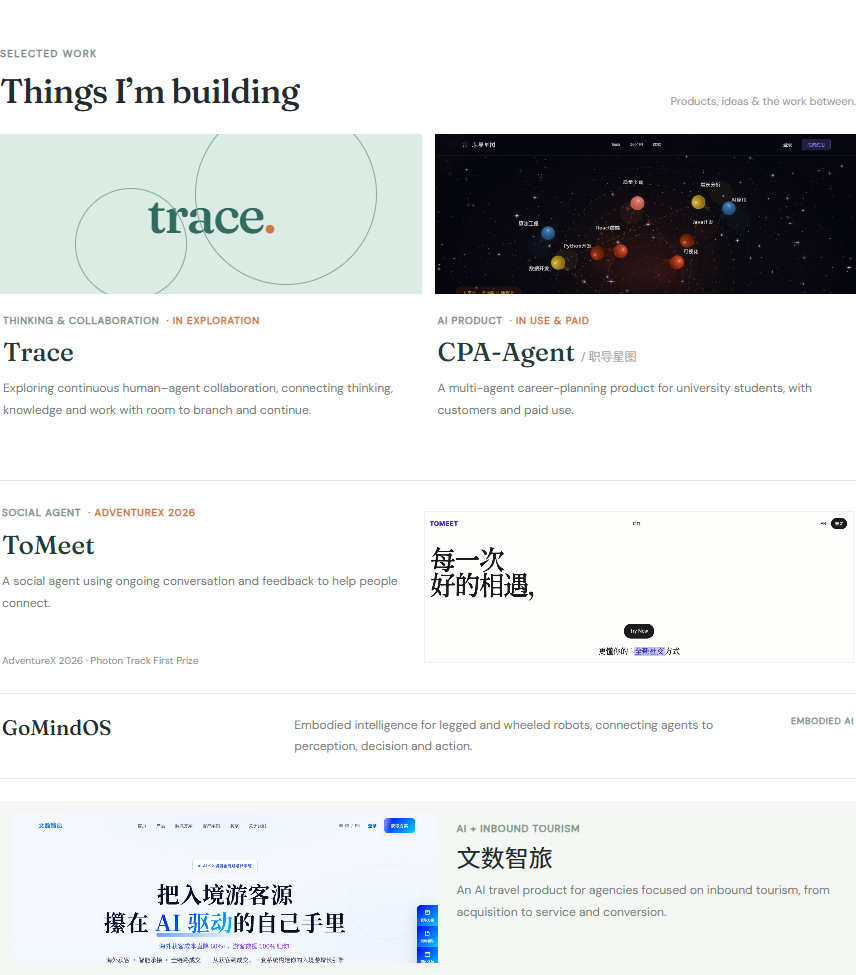
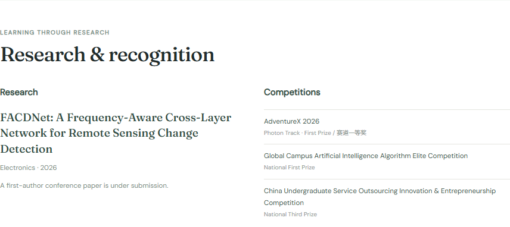
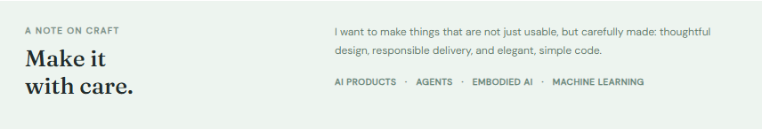
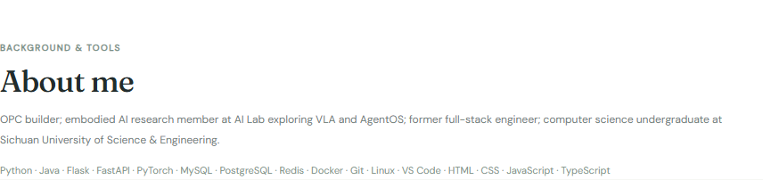

<a href="./README.md">简体中文</a> · <strong>English</strong>

<picture>
  <source media="(max-width: 600px)" srcset="./assets/v2/hero-en-mobile.png">
  
</picture>

<picture>
  <source media="(max-width: 600px)" srcset="./assets/v2/intro-en-mobile.png">
  
</picture>

<picture>
  <source media="(max-width: 600px)" srcset="./assets/v2/work-en-mobile.png">
  
</picture>

**Explore** &nbsp; [CPA-Agent repository](https://github.com/WHaoxM/cpa-agent) · [CPA-Agent website](https://www.xingtulabs.top/) · [ToMeet website](https://www.tomeet.chat/) · [ToMeet repository](https://github.com/toMeetADX/TOMEET_Backend) · [Zhilv Travel](https://www.zhilvtravel.com/)

<picture>
  <source media="(max-width: 600px)" srcset="./assets/v2/research-en-mobile.png">
  
</picture>

[Read the FACDNet paper ↗](https://www.mdpi.com/2079-9292/15/11/2416)

<picture>
  <source media="(max-width: 600px)" srcset="./assets/v2/craft-en-mobile.png">
  
</picture>

<picture>
  <source media="(max-width: 600px)" srcset="./assets/v2/about-en-mobile.png">
  
</picture>

[Get in touch ↗](mailto:freezingm2020@outlook.com)

Accessible text

I’m NeuTronM, or Neu. I build AI products and agents, and explore embodied intelligence, machine learning, and entrepreneurship, while refining my design taste, delivery, code, and research skills.

- **Trace**: Exploring continuous human–agent collaboration, connecting thinking, knowledge and work with room to branch and continue.
- **CPA-Agent**: A multi-agent career-planning product for university students, with customers and paid use.
- **ToMeet**: A social agent using ongoing conversation and feedback to help people connect.
- **GoMindOS**: Embodied intelligence for legged and wheeled robots, connecting agents to perception, decision and action.
- **Zhilv Travel**: An AI travel product for agencies focused on inbound tourism, from acquisition to service and conversion.

**Research**: [FACDNet](https://www.mdpi.com/2079-9292/15/11/2416), Electronics, 2026; a first-author conference paper is under submission.

**Competitions**: AdventureX 2026 Photon Track First Prize; Global Campus Artificial Intelligence Algorithm Elite Competition National First Prize; China Undergraduate Service Outsourcing Innovation & Entrepreneurship Competition National Third Prize.

**Background**: OPC builder; embodied AI research member at AI Lab exploring VLA and AgentOS; former full-stack engineer; computer science undergraduate at Sichuan University of Science & Engineering.

**Tools**: Python · Java · Flask · FastAPI · PyTorch · MySQL · PostgreSQL · Redis · Docker · Git · Linux · VS Code · HTML · CSS · JavaScript · TypeScript

