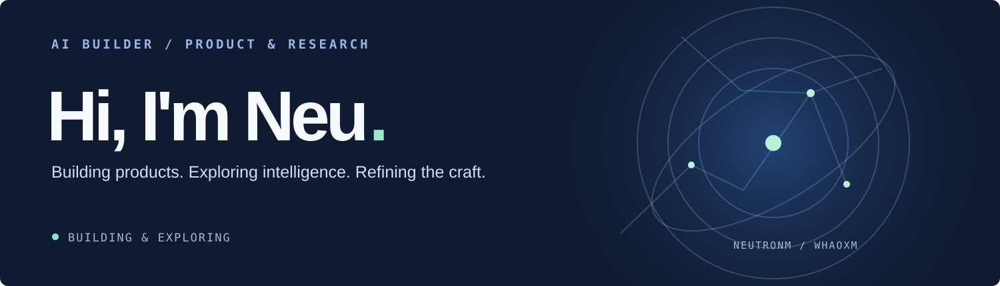
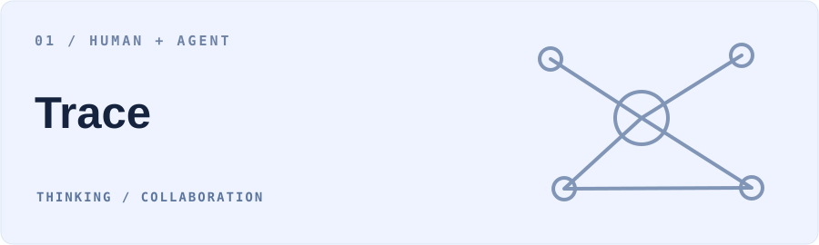
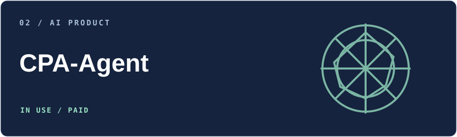
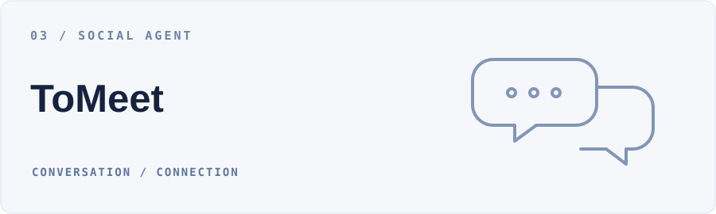
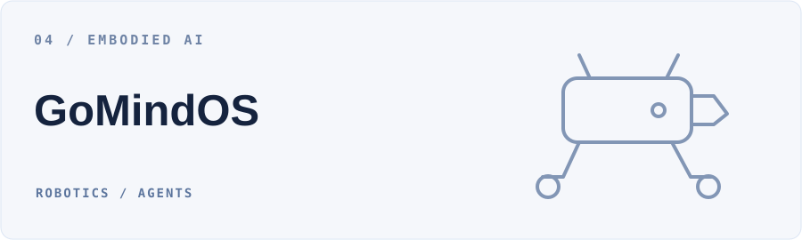
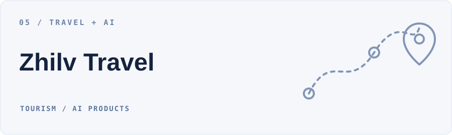

<a href="./README.md">English</a> · <strong>简体中文</strong>

你好，我是 **NeuTronM**，也可以叫我 **Neu**。我关注 AI 产品、Agent 研发、具身智能与机器学习，也在探索创业。我希望把想法做成真实可用的产品。

我持续做科研，打磨算法与模型能力；也在培养产品审美，对交付的细节负责，学习把代码写得更优雅、更简洁。

### 01 / 正在做的产品

探索人与 Agent 的持续协作，让思考、知识与工作围绕同一件事连接起来，支持非线性的探索、交接与接续。

面向大学生职业规划的多智能体产品，连接能力画像、人岗匹配与职业发展。目前已有客户使用，并进入付费阶段。

[项目仓库 ↗](https://github.com/WHaoxM/cpa-agent) · [前端演示 ↗](https://whaoxm.github.io/cpa-xingtu/)

一个可以长期对话的社交 Agent，通过持续了解与互动反馈，帮助人建立连接。

[项目仓库 ↗](https://github.com/toMeetADX/TOMEET_Backend) · AdventureX 2026 · Photon 赛道一等奖

面向足式和轮式机器人的具身智能系统，探索 AI Agent 与真实环境、感知、决策和行动的连接。

面向旅行社的 AI 文旅产品，聚焦入境游，探索从海外获客到智能承接与业务成交的服务链路。

[访问官网 ↗](https://www.zhilvtravel.com/)

### 02 / 科研

持续开展机器学习研究，在具体问题中打磨算法与模型能力。

- [**FACDNet: A Frequency-Aware Cross-Layer Network for Remote Sensing Change Detection**](https://www.mdpi.com/2079-9292/15/11/2416) — *Electronics*，2026。
- 另有一篇第一作者会议论文投稿中。

### 03 / 竞赛与荣誉

- 🏆 **AdventureX 2026** — Photon 赛道一等奖
- 🥇 **全球校园人工智能算法精英大赛** — 国家一等奖
- 🥉 **中国大学生服务外包创新创业大赛** — 国家三等奖

### 04 / 关于我

- **OPC Builder**，探索 AI Native 产品与创业。
- **AI Lab 具身智能研究成员**，探索 Vision-Language-Action（VLA）与 AgentOS。
- 曾担任软件公司的**全栈开发工程师**。
- 四川轻化工大学（SUSE）**计算机科学与技术专业本科生**。
- 持续打磨产品审美、交付质量与优雅简洁的代码。

**关注方向** &nbsp; AI 产品 · Agents · 具身智能 · 机器学习

**语言与工具** &nbsp; Python · Java · Flask · FastAPI · PyTorch · MySQL · PostgreSQL · Redis · Docker · Git · Linux · VS Code · HTML · CSS · JavaScript · TypeScript

**联系我** &nbsp; [freezingm2020@outlook.com](mailto:freezingm2020@outlook.com)
